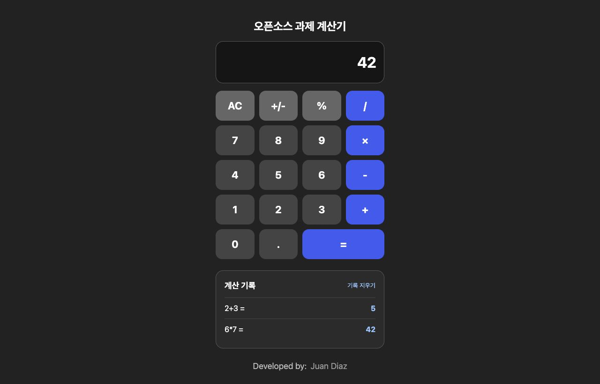

# 오픈소스 스튜디오 과제 4-2

학번 22300344 배산

## 1 프로젝트 정보

프로젝트 리액트 계산기 React Calculator

원본 깃허브: https://github.com/JuanPabloDiaz/calculator

라이선스 MIT. 원작자 Juan Diaz의 저작권 표시는 [license](./license)에 그대로 유지함.

선택이유 남들 다 투두리스트 할거같아서 좀 덜 흔한 계산기로 찾아봤음 보니까 백엔드나 디비도 없고 프론트로만 딱 돌아가서 과제 조건에 젤 맞아보였음 사칙연산이랑 초기화 AC 되는 기본 계산기임. 소수 입력이랑 부호 변경도 됨.

## 2 설치랑 실행방법

```bash
git clone https://github.com/2026-2-OSS/assign11-c02-22300344.git
cd assign11-c02-22300344
npm install
npm run dev
```

package.json의 실행 명령어가 dev로 되어있음. 터미널에 나오는 로컬 주소를 브라우저로 열면 됨.

빌드는 아래 명령어로 확인함.

```bash
npm run build
```

### 수정 후 실행화면



## 3 소스코드 탐색

### 주요 파일

- package.json 이거 실행하는 명령어랑 라이브러리 뭐뭐 깔려있는지 들어있음
- src/App.jsx 계산기 메인 화면 껍데기랑 계산 돌아가는 로직 싹다 여기있음
- index.html 브라우저 탭 이름이나 기본 뼈대 설정하는곳

### 컴포넌트

이 프로젝트는 버튼이 따로 컴포넌트로 안쪼개져있고 걍 App.jsx 안에 하드코딩으로 버튼들이 쌩으로 다 들어가있음. 그래서 App 컴포넌트가 젤 메인이고 맨 밑에 원작자 개인 사이트 링크 띄워주는 Footer 컴포넌트 일케 2개로 되어있음. Footer 파일은 src/Components/Footer.jsx임.

### 코드 분석

src/App.jsx의 calculate 함수 중 계산하고 기록을 추가하는 부분임.

```javascript
    try {
      const answer = eval(result);
      if (!Number.isFinite(answer)) {
        setResult("Error");
        return;
      }
      setResult(String(answer));
      setHistory((previous) => [
        ...previous,
        { expression: result, answer: String(answer) },
      ]);
    } catch {
      setResult("Error");
    }
```

등호 버튼 누르면 calculate 함수가 실행됨. switch문으로 연산을 나누는 대신 원본의 eval 함수로 입력한 문자열 result를 계산함. 계산된 answer를 화면에 띄우고 history 배열에는 수식 expression이랑 결과 answer를 객체로 넣음. previous를 펼친 뒤 새 기록을 추가해서 이전 기록도 남음. 계산 결과가 유한한 숫자가 아니거나 잘못된 수식이면 Error가 표시됨. eval은 문자열을 코드로 실행하므로 보안상 주의가 필요한 함수임.

## 4 커스터마이징 수정한거

세가지 바꿨음.

1. Text: index.html에서 브라우저 탭 이름을 Calculator에서 오픈소스 과제 계산기로 바꿈. src/App.jsx에는 원래 없던 화면 제목 오픈소스 과제 계산기를 추가함.
2. Style: src/App.css 파일에서 원래 회색 계열 배경을 #222로 바꾸고 플러스 마이너스 같은 연산자 버튼들을 주황색에서 파란색으로 바꿈. src/App.jsx의 버튼 클래스도 수정했고 src/Components/Footer.jsx의 원작자 표시 위치는 고정 위치에서 화면 아래로 바꿔 기록 영역과 안 겹치게 함.
3. UI/Data: 원래 계산 기록이 없었는데 화면 밑에 계산 기록 영역을 추가함. src/App.jsx에서 history 배열에 수식과 결과를 넣고 ol, li 태그로 리스트를 표시함. 기록 지우기 버튼도 추가했고 src/App.css에서 기록 영역 스타일을 설정함. 기록은 새로고침하면 초기화됨.

### 수정 전 화면 — 원본 저장소에 포함된 이미지


### 수정 후 화면


## 5 배포

클래스룸 깃헙: https://github.com/2026-2-OSS/assign11-c02-22300344

개인 Fork: https://github.com/distort1074/assign11-c02-22300344

버셀 배포주소: https://assign11-c02-22300344.vercel.app/

Text, Style, UI/Data를 각각 별도 커밋으로 올렸음. 배포 사이트에서 2+3=5, 6×7=42 계산이랑 기록이 누적되는 동작을 AI 도구로 확인함.

## 6 위클리 리뷰

### 새로 배운거 3개

1. 커밋할때 텍스트 변경 스타일 변경 일케 작업별로 쪼개서 커밋하니까 나중에 깃헙 기록 history 볼때 개편하다는거 배움
2. 버셀 첨써보는데 깃헙 연결해두면 푸시할때마다 오토디플로이 되는거 첨 암
3. 자바스크립트에서 eval 함수 쓰면 문자열 수식이 계산된다는거 원본 코드에서 배웠음. 다만 문자열을 코드로 실행해서 주의가 필요한 방식임.

### 어려웠던점, AI 활용과 느낀점

계산 기록은 새 결과만 저장하면 이전 기록이 사라질 수 있어서 기존 배열을 복사하고 새 값을 붙이는 방식으로 처리함. 이 부분을 포함한 제목, 스타일, 계산 기록 코드 수정은 AI 도움을 받아 진행했고 커밋과 Push, 실행 검증도 AI가 수행함. 개발 환경 설치와 코드 개념 설명에도 도움을 받음. 프로젝트 선택과 Vercel 배포 주소 공유는 직접 했음. README는 직접 제공한 초안을 바탕으로 AI가 실제 코드와 주소에 맞게 수정하고 파일에 반영함.

깃헙에 올리고 버셀에 배포되는거 보니까 진짜 배포한 기분들어서 뿌듯함 담번 과제도 왠만하면 직접 해봐야겟음.
